<p align="center">
  
</p>

<h1 align="center">Pulso do Território</h1>

<p align="center">
  <b>Indicadores, previsões e alertas explicáveis para que gestores e cidadãos antecipem problemas de água, energia, clima e serviços, com a decisão final sempre nas mãos de uma pessoa.</b>
</p>

<p align="center">
  Global Solution 2026.2 · Cross-Platform Application Development · FIAP · <i>Territory Predictive Insights</i>
</p>

> O nome vem da ideia de "medir o pulso" da cidade: acompanhar os sinais vitais do bairro (água, energia, clima, lixo e chamados) para perceber quando algo não vai bem antes que vire problema.

---

## 1. Problema e público

**O problema:** em São Paulo, os sinais de que algo vai dar errado quase sempre aparecem antes nos dados: o consumo de água sobe por semanas antes do desabastecimento, a previsão avisa da chuva forte dias antes do alagamento e os chamados de zeladoria crescem antes de o serviço entrar em colapso. Só que esses dados ficam espalhados, chegam tarde e quase nunca vêm com uma explicação que permita confiar (ou desconfiar) deles.

**Território:** município de São Paulo, dividido em cinco regiões (Centro, Zona Norte, Zona Sul, Zona Leste e Zona Oeste).

**Para quem:**

- **Gestores públicos** (subprefeitura, Defesa Civil, zeladoria): veem num só lugar os três painéis com histórico e tendência, os alertas com evidência e nível de confiança, ajustam os limiares e registram a decisão tomada.
- **Cidadãos:** acompanham a situação da região em linguagem simples, veem o mapa de alertas e registram ocorrências de forma anônima.

**Impacto social esperado:** ganhar **dias de antecedência** para agir: reduzir desperdício de água, proteger moradores de áreas de risco antes da chuva forte, avisar grupos vulneráveis sobre calor e ar ruim e evitar a sobrecarga dos serviços. A tela inicial mostra isso em números: o **Índice de Bem-Estar do território**, os **litros de água que dá para poupar por dia**, **quantas pessoas esse volume abasteceria** e os **relatos da comunidade**.

---

## 2. Integrantes

| Nome completo                  | RM     |
| ------------------------------ | ------ |
| Marco Antonio Ferreira Fonseca | 566434 |
| Bruno Soares de Santanna       | 562235 |
| Enzo Yokokura Araujo           | 564177 |

---

## 3. Demonstração visual

Capturas da execução real do app, com os dados de clima do dia da captura.

|                                                        Consentimento                                                         |                                                           Início (visão geral)                                                            |
| :--------------------------------------------------------------------------------------------------------------------------: | :---------------------------------------------------------------------------------------------------------------------------------------: |
| 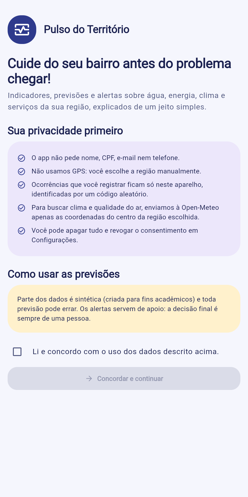<br>_O que é coletado e aceite explícito no primeiro acesso._ | 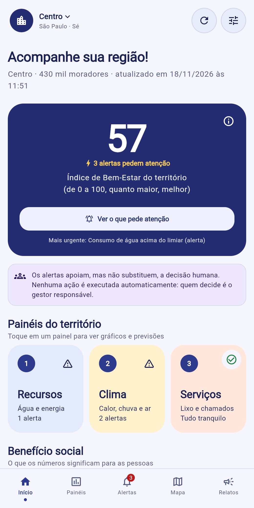<br>_Índice de Bem-Estar em destaque, painéis numerados e benefício social._ |

|                                                   Painel 1 · Recursos                                                   |                                                    Painel 2 · Clima                                                     |
| :---------------------------------------------------------------------------------------------------------------------: | :---------------------------------------------------------------------------------------------------------------------: |
| 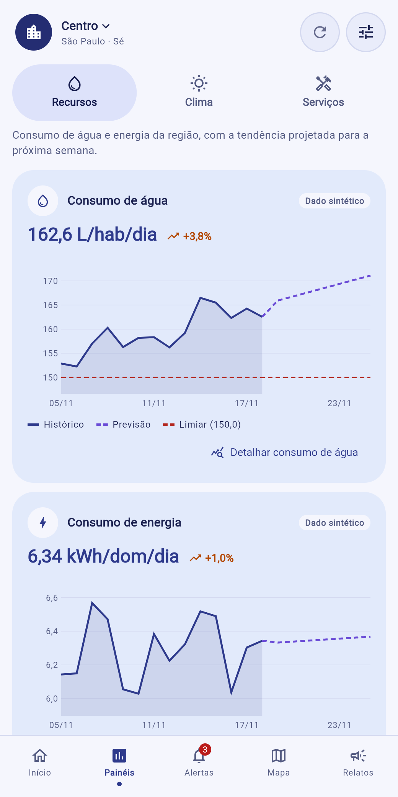<br>_Água e energia com histórico, previsão e limiar._ | 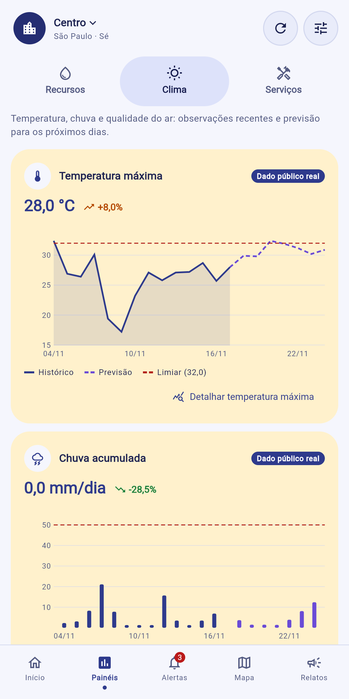<br>_Temperatura, chuva e qualidade do ar (dados reais)._ |

|                                                Painel 3 · Serviços                                                |                                                   Detalhe do indicador                                                   |
| :---------------------------------------------------------------------------------------------------------------: | :----------------------------------------------------------------------------------------------------------------------: |
| 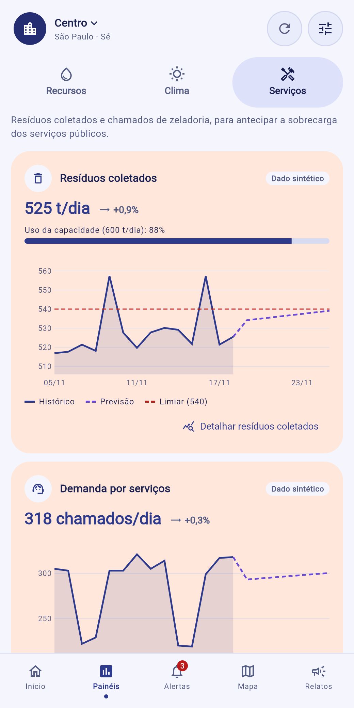<br>_Resíduos, capacidade de coleta e chamados._ | 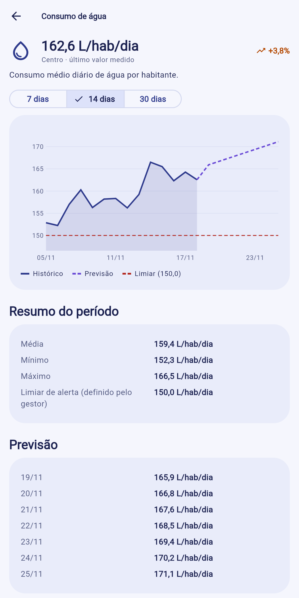<br>_Período ajustável, previsão dia a dia e método._ |

|                                                          Alertas                                                          |                                                      Detalhe do alerta                                                      |
| :-----------------------------------------------------------------------------------------------------------------------: | :-------------------------------------------------------------------------------------------------------------------------: |
| 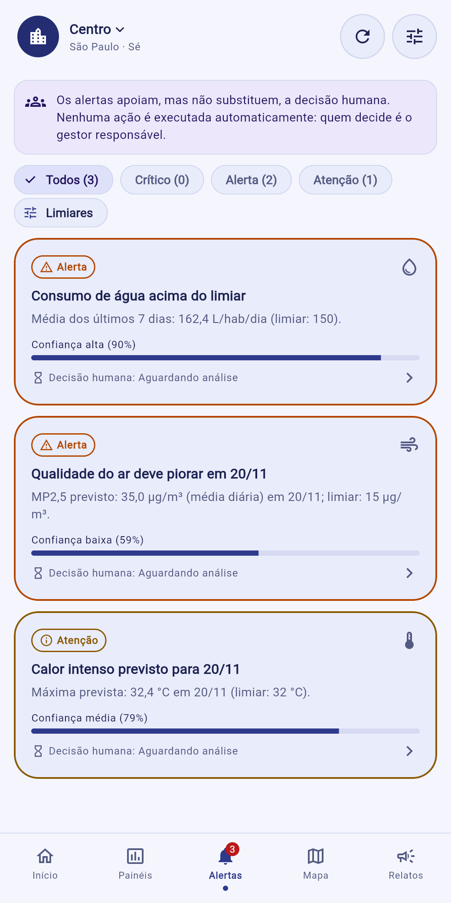<br>_Lista com filtro por severidade e aviso de decisão humana._ | 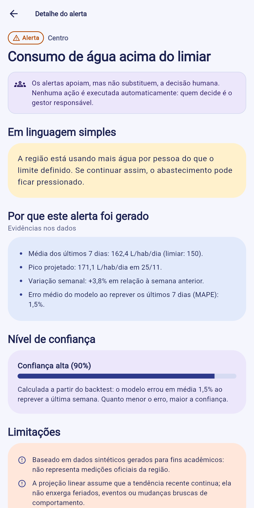<br>_Linguagem simples, evidência, confiança e limitações._ |

|                                                   Mapa                                                   |                                            Relatos da comunidade                                            |
| :------------------------------------------------------------------------------------------------------: | :---------------------------------------------------------------------------------------------------------: |
| 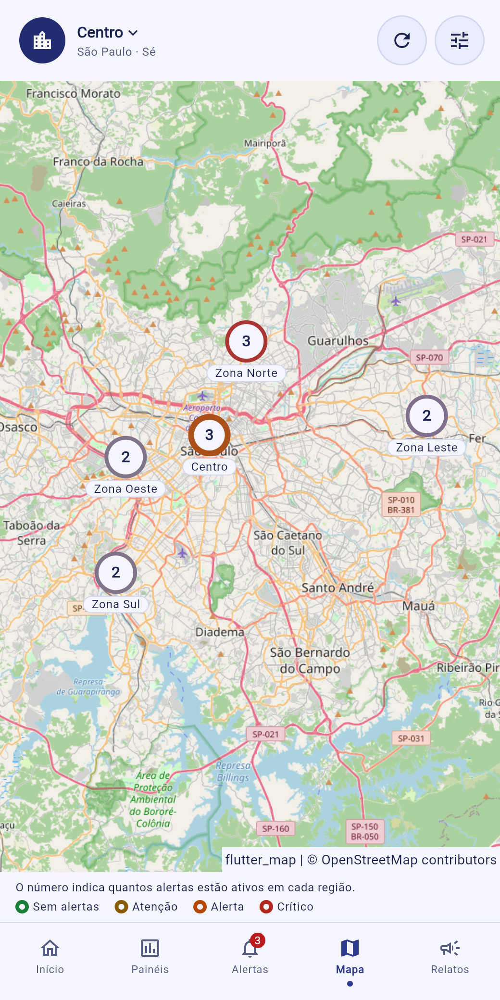<br>_Quantidade de alertas ativos em cada região._ | 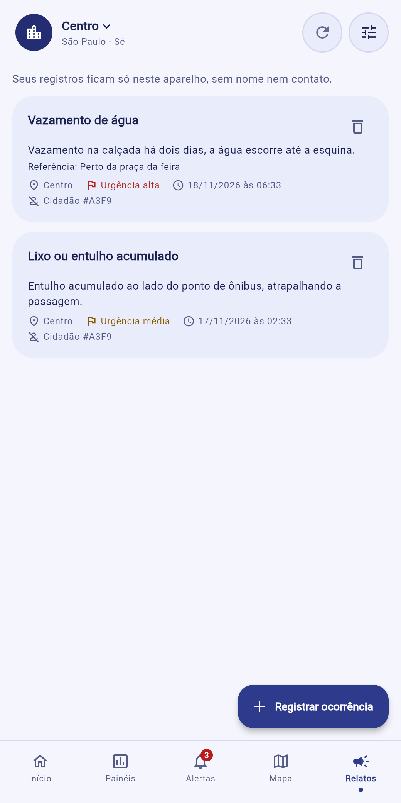<br>_Ocorrências anônimas salvas no aparelho._ |

|                                                    Registrar ocorrência                                                    |                                               Limiares de alerta                                                |
| :------------------------------------------------------------------------------------------------------------------------: | :-------------------------------------------------------------------------------------------------------------: |
| 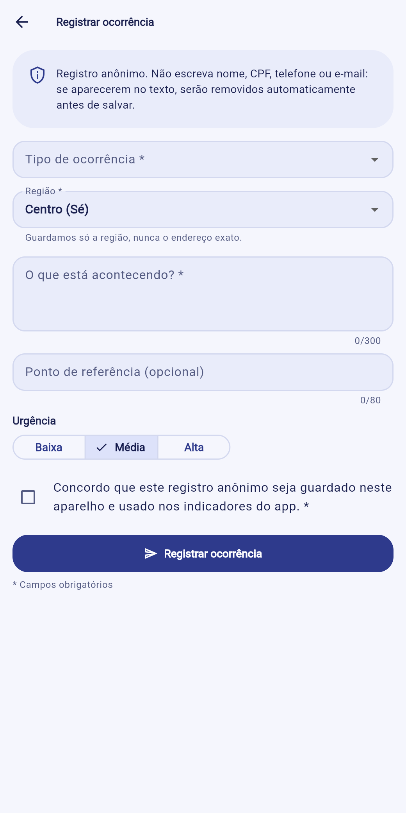<br>_Formulário com validação e anonimização automática._ | 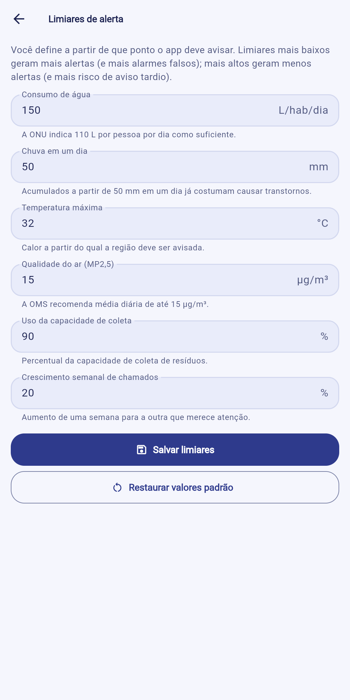<br>_O gestor define a partir de quando o app avisa._ |

|                                                   Configurações                                                    |                                         Sobre e metodologia                                         |
| :----------------------------------------------------------------------------------------------------------------: | :-------------------------------------------------------------------------------------------------: |
| 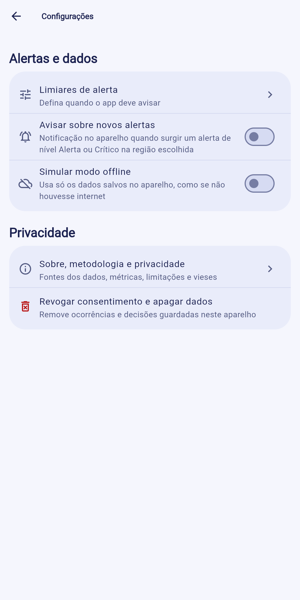<br>_Limiares, avisos, modo offline e privacidade._ | 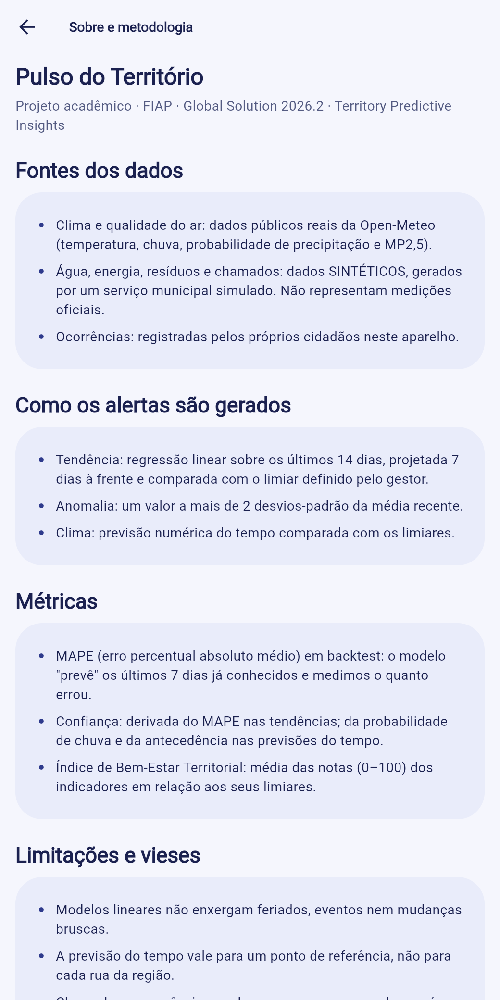<br>_Fontes, métricas, limitações e vieses._ |

|                                                     Alto contraste (automático)                                                      |                                                Página não encontrada                                                |
| :----------------------------------------------------------------------------------------------------------------------------------: | :-----------------------------------------------------------------------------------------------------------------: |
| 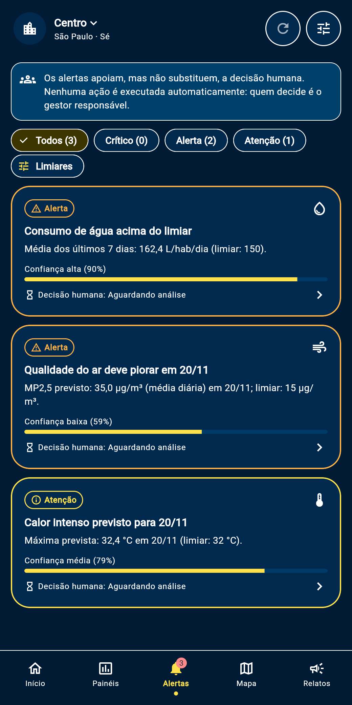<br>_Liga sozinho quando o celular está com alto contraste ativado._ | 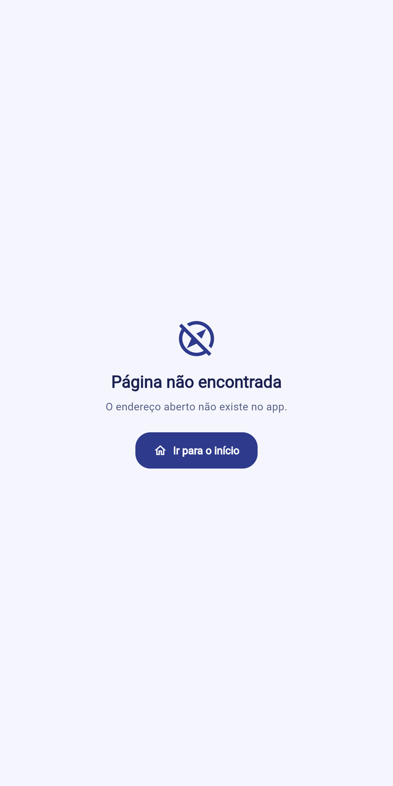<br>_Endereço inexistente leva de volta ao início._ |

**Tela larga (tablet/web):** a barra inferior vira um trilho lateral e os cartões se reorganizam em colunas.

<p align="center">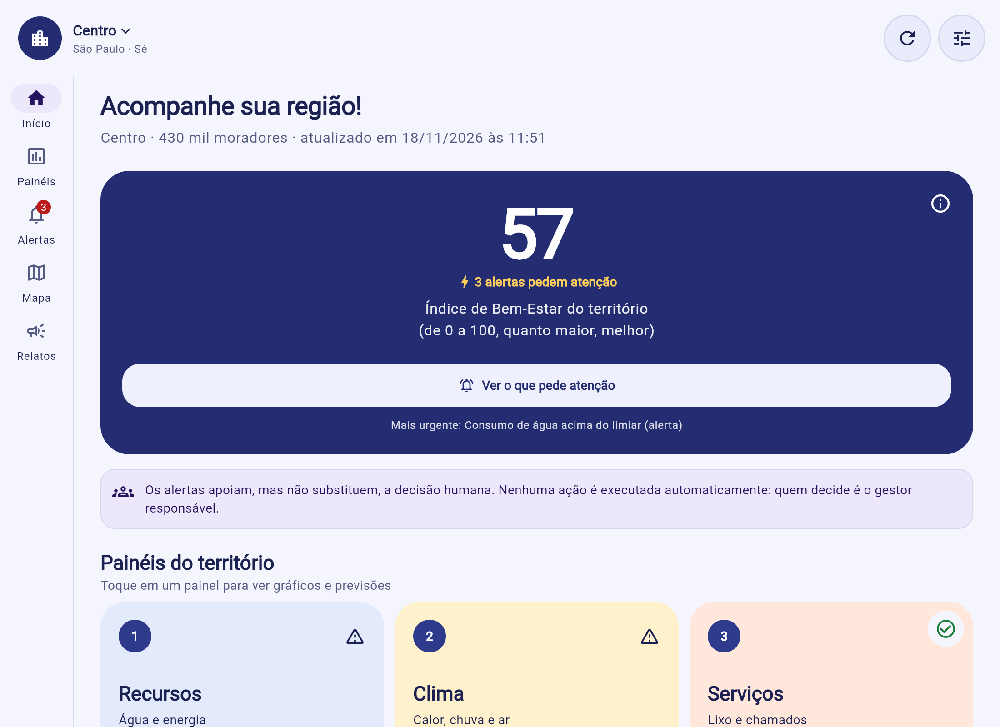</p>

---

## 4. Funcionalidades

**Navegação e telas**

- [x] 13 telas com **rotas nomeadas** (`go_router`) e **passagem de parâmetros** de rota (`/indicador/:indicatorId`, `/alerta/:alertId`) e de consulta (`?aba=paineis&painel=clima`)
- [x] Fluxo coerente: **Início → Painel → Detalhe do indicador → Detalhe do alerta**
- [x] Barra inferior com 5 abas (Início, Painéis, Alertas, Mapa, Relatos) e contador de alertas
- [x] Consentimento obrigatório antes de qualquer tela e página própria para endereço inexistente

**Dashboards territoriais (3)**

- [x] **Recursos:** consumo de água e de energia
- [x] **Clima:** temperatura máxima, chuva e qualidade do ar (MP2,5), com tabela dos próximos dias
- [x] **Serviços:** resíduos coletados (com uso da capacidade) e chamados por categoria
- [x] Gráficos com histórico (linha cheia), previsão (tracejada) e limiar de alerta; cartões com valor atual, variação da semana e selo "dado real" ou "dado sintético"

**Alertas preditivos e transparência**

- [x] 7 regras de alerta geradas a partir dos dados e dos limiares (ATENÇÃO, ALERTA, CRÍTICO)
- [x] Cada alerta mostra: **explicação em linguagem simples**, **evidências**, **nível de confiança** (barra + porcentagem + como foi calculado), **limitações**, **quando não confiar**, caminhos para avaliar e benefício social
- [x] Aviso visível de que **a decisão final é humana**
- [x] Registro da decisão humana por alerta (em análise, ação decidida, descartado), com justificativa obrigatória

**Estado, dados e persistência**

- [x] Estado global (`provider`) compartilhado entre as telas; estado local para abas, filtros, período do gráfico e formulários
- [x] Estados de **carregamento**, **erro** (com "Tentar novamente") e **lista vazia** tratados
- [x] Consumo da **API real Open-Meteo** + serviço municipal simulado
- [x] Persistência local: cache dos dados por região, limiares, região escolhida, ocorrências, decisões e consentimento
- [x] **Funciona sem internet** com os dados salvos e avisa a data da última atualização (chave "Simular modo offline" para demonstrar)

**Formulários com validação**

- [x] **Registro de ocorrência** (tipo, região, descrição, ponto de referência, urgência e aceite) com mensagens de erro claras
- [x] **Limiares de alerta** (número, faixa permitida e vírgula ou ponto aceitos)
- [x] **Decisão sobre o alerta** (justificativa obrigatória ao decidir ou descartar)

**Identidade visual, acessibilidade e privacidade**

- [x] Identidade própria em azul-índigo com fundos lavanda e tons pastel, tema e componentes reutilizáveis (ver seção 7, Identidade visual)
- [x] **Alto contraste automático**, seguindo a opção de acessibilidade do aparelho
- [x] Suporte a **fonte ampliada** e **leitores de tela**
- [x] Consentimento explícito, anonimização automática e botão para apagar os dados
- [x] Layout responsivo (1, 2 ou 3 colunas e trilho lateral em telas largas)

**Diferenciais**

- [x] Dados reais (Open-Meteo)
- [x] Mapa e geolocalização das regiões (OpenStreetMap)
- [x] Animações com propósito (entrada do índice, troca de abas, indicador da aba ativa)
- [x] Testes automatizados (32 testes de unidade e de widget)
- [x] Notificações locais: aviso no aparelho quando surge um alerta novo de nível ALERTA ou CRÍTICO; tocar no aviso abre o detalhe do alerta (opcional, ligado em Configurações)
- [ ] Explicação por IA generativa (a linguagem simples vem de textos fixos, não de um LLM)
- [x] APK de release (em [Releases](https://github.com/marc0odev/pulso-territorio_cpad-gs2/releases/tag/pulso-territorio))

---

## 5. Dados e alertas

### Fontes de dados

| Painel              | Fonte                                                                                                                                         | Tipo              | Como chega ao app                                                                                       |
| ------------------- | --------------------------------------------------------------------------------------------------------------------------------------------- | ----------------- | ------------------------------------------------------------------------------------------------------- |
| Clima               | [Open-Meteo Forecast](https://open-meteo.com/en/docs) – temperatura máxima, chuva e probabilidade de chuva (14 dias passados + 7 de previsão) | **Público, real** | API HTTP gratuita, sem chave. A resposta é salva no aparelho (cache).                                   |
| Clima               | [Open-Meteo Air Quality](https://open-meteo.com/en/docs/air-quality-api) – MP2,5 (modelo CAMS)                                                | **Público, real** | Leituras horárias agregadas em média diária.                                                            |
| Recursos e Serviços | Água, energia, resíduos e chamados                                                                                                            | **Sintético**     | `SimulatedCityApi`: série determinística por região e dia, com tendência, sazonalidade semanal e ruído. |
| Relatos             | Ocorrências do próprio usuário                                                                                                                | **Autorizado**    | Registradas com consentimento e salvas só no aparelho.                                                  |
| Mapa                | [OpenStreetMap](https://www.openstreetmap.org/copyright)                                                                                      | Público           | Mapa base.                                                                                              |

Os dados sintéticos **não representam medições oficiais** e cada cartão traz o selo "Dado sintético". Populações e capacidade de coleta são aproximações ilustrativas.

### Como os alertas são gerados (`lib/domain/alert_engine.dart`)

O motor é uma função pura: recebe os dados da região e os limiares e devolve a lista de alertas. Ele só sinaliza, nunca executa uma ação.

| Alerta               | Regra                                          | Limiar padrão (ajustável)    | Confiança                             |
| -------------------- | ---------------------------------------------- | ---------------------------- | ------------------------------------- |
| Consumo de água      | Média de 7 dias ou projeção de 7 dias ≥ limiar | 150 L/hab/dia                | Derivada do erro do modelo (MAPE)     |
| Pico de energia      | Último valor ≥ 2 desvios-padrão acima da média | 2 desvios                    | Cresce com o desvio (máx. 85%)        |
| Chuva forte          | Chuva prevista em um dia ≥ limiar              | 50 mm                        | Probabilidade de chuva × antecedência |
| Calor intenso        | Máxima prevista ≥ limiar                       | 32 °C                        | 88% × antecedência                    |
| Qualidade do ar      | MP2,5 médio previsto ≥ limiar                  | 15 µg/m³ (diretriz OMS 2021) | 65% × antecedência                    |
| Coleta de resíduos   | Projeção ≥ % da capacidade                     | 90%                          | Derivada do MAPE                      |
| Demanda por serviços | Crescimento semanal dos chamados ≥ limiar      | 20%                          | Derivada do MAPE                      |

Os limiares são **referências do grupo**, não valores oficiais, e podem ser mudados na tela **Limiares de alerta**; os alertas são recalculados na hora.

### Métricas exibidas

- **Erro do modelo (MAPE em backtest):** o modelo "esconde" os últimos 7 dias conhecidos, tenta prevê-los e mede o erro percentual médio. Aparece no detalhe do indicador e em cada alerta.
- **Confiança (0–100%):**
  - _Tendências:_ `1 − 2 × MAPE`, limitada entre 35% e 90% (erro de 5% → 90%; 10% → 80%; 20% → 60%).
  - _Previsão do tempo:_ multiplicada pelo fator de antecedência (1,0 até amanhã; 0,9 até 3 dias; 0,75 depois).
  - _Rótulos:_ alta (≥ 80%), média (≥ 60%), baixa (< 60%).
- **Índice de Bem-Estar do território (0–100):** média das notas dos indicadores; cada nota vale 100 até 80% do limiar e cai até 0 em 140%.
- **Água que dá para poupar:** `(consumo médio − 110 L) × população`, usando 110 L por pessoa por dia como referência da ONU.

### Quando as previsões NÃO são confiáveis (e o que o app faz)

| Situação                                           | O que o app faz                                                                          |
| -------------------------------------------------- | ---------------------------------------------------------------------------------------- |
| Menos de 14 dias de histórico em uma série         | **Não emite** os alertas de água, energia e serviços (fica em silêncio em vez de chutar) |
| Histórico curto demais para medir o erro do modelo | Usa confiança de 50% e avisa no alerta                                                   |
| Previsão para mais de 3 dias à frente              | **Reduz a confiança** (fator 0,75)                                                       |
| Sem internet                                       | Usa os dados salvos e mostra "Sem conexão. Exibindo dados salvos em…"                    |
| Só a API de clima falhou                           | Mantém os demais painéis e reaproveita a última previsão salva, com aviso                |
| Sem internet e sem dados salvos                    | Tela de erro explicando o que fazer, com "Tentar novamente"                              |
| Feriados, grandes eventos, temporais isolados      | Listados em cada alerta, na seção "Quando NÃO confiar nesta previsão"                    |

### Limitações e possíveis vieses

- **Tendência linear:** assume que o ritmo recente continua; não enxerga feriados, eventos nem mudanças bruscas.
- **Um ponto por região:** a previsão do tempo vale para uma coordenada de referência; bairros vizinhos podem ter chuvas bem diferentes e o volume diário não mostra a intensidade por hora.
- **Qualidade do ar de modelo global:** resolução de dezenas de quilômetros, não substitui estações locais.
- **Viés de sub-registro:** chamados e relatos medem quem consegue reclamar. Regiões com menos acesso digital aparecem menos, mesmo tendo mais problemas.
- **Viés de limiar único:** o mesmo limiar para regiões diferentes pode gerar alarmes demais em umas e de menos em outras.
- **Índice simplificado:** todos os indicadores têm o mesmo peso.
- **Avisos dependem de o app atualizar os dados:** a notificação é gerada quando o app carrega dados novos ou os limiares mudam; não há busca agendada com o app fechado.

> **A decisão final é sempre humana.** O app nunca dispara nenhuma ação sozinho. Ele mostra a evidência, a confiança e as limitações, sugere caminhos com verbos brandos ("avaliar", "acompanhar", "verificar") e registra o que a pessoa responsável decidiu.

---

## 6. Privacidade e inclusão

**Privacidade**

- **Consentimento explícito** na primeira abertura; sem aceitar, nenhuma tela é liberada. Há um segundo aceite em cada ocorrência enviada.
- **Minimização:** sem cadastro, nome, e-mail, telefone ou GPS. A região é escolhida numa lista.
- **Anonimização automática:** cada aparelho recebe um código aleatório (ex.: `Cidadão #A3F9`) e textos livres passam por um filtro que remove e-mails, CPFs e telefones antes de salvar (`lib/core/utils/anonymizer.dart`).
- **Tudo fica no aparelho** (`shared_preferences`). A única informação enviada para fora são as coordenadas do centro da região, para a Open-Meteo.
- **Direito de apagar:** Configurações → "Revogar consentimento e apagar dados".
- **Notificações só com permissão:** vêm desligadas, a permissão do sistema só é pedida quando a pessoa ativa a opção, e o aviso é gerado no próprio aparelho (nenhum servidor de push recebe dados).
- **Sem chaves de API** no código (as fontes usadas são abertas).

**Acessibilidade e inclusão**

- **Linguagem simples** em todo alerta e títulos convidativos ("Acompanhe sua região!"), pensados para quem não é especialista.
- **Tema de alto contraste** (azul-marinho com amarelo), ativado automaticamente pela opção de acessibilidade do aparelho, sem precisar procurar um botão no app.
- **Severidade nunca indicada só por cor:** toda etiqueta tem ícone + texto.
- **Fonte ampliada:** os layouts não têm alturas fixas e as grades diminuem o número de colunas quando o texto cresce.
- **Leitor de tela:** rótulos (`Semantics`) em cartões, gráficos (o leitor fala o último valor, o maior valor previsto e o limiar), etiquetas, barra de confiança e todos os botões de ícone (`tooltip`).
- Botões principais com pelo menos 48 px de altura; responsivo de 293 px a telas de tablet.

---

## 7. Tecnologias e decisões técnicas

| Escolha                              | Por quê                                                                                                                                                                                                                           |
| ------------------------------------ | --------------------------------------------------------------------------------------------------------------------------------------------------------------------------------------------------------------------------------- |
| **Flutter 3.47 + Dart 3.13**         | Exigência da disciplina; um código só para Android, iOS e web.                                                                                                                                                                    |
| **provider**                         | Gerenciamento de estado simples de explicar (`ChangeNotifier` + `context.watch`). Cinco estados globais: configurações, território, relatos, decisões e notificações. Estado local (`setState`) para abas, filtros e formulários. |
| **go_router**                        | Rotas nomeadas, parâmetros de rota e de consulta e redirecionamento para o consentimento.                                                                                                                                         |
| **http**                             | Cliente HTTP oficial; basta para duas chamadas GET.                                                                                                                                                                               |
| **shared_preferences**               | Os dados salvos são pequenos (chave → JSON); um banco SQL seria exagero.                                                                                                                                                          |
| **fl_chart**                         | Gráficos de linha e de barras com linha de limiar e trecho tracejado para a previsão.                                                                                                                                             |
| **flutter_map + latlong2**           | Mapa com OpenStreetMap, sem chave de API nem cobrança.                                                                                                                                                                            |
| **flutter_local_notifications**      | Avisos locais no Android, iOS e navegador, sem servidor de push: o aviso nasce no próprio aparelho quando os dados são atualizados.                                                                                               |
| **Open-Meteo**                       | API de clima aberta, gratuita e **sem chave**: nenhuma credencial no repositório.                                                                                                                                                 |
| **Regressão linear e desvio-padrão** | Modelos simples e explicáveis, com erro medido por backtest.                                                                                                                                                                      |

### Identidade visual

Inspirada em apps de acompanhamento pessoal (títulos grandes, cartões bem arredondados, etapas numeradas e um número em destaque). O **azul-índigo** passa a seriedade de um serviço público, e os **fundos lavanda e tons pastel** deixam o app acolhedor para qualquer pessoa, longe do visual "preto, branco e cinza" de ferramentas técnicas. Só cores sólidas, sem degradês.

| Elemento        | Cor       | Onde aparece                               |
| --------------- | --------- | ------------------------------------------ |
| Índigo          | `#2E3A8C` | Cor principal, botões, logo                |
| Índigo profundo | `#242D72` | Cartão de destaque do Índice de Bem-Estar  |
| Lavanda clara   | `#F5F6FD` | Fundo das telas                            |
| Céu             | `#E2EAFB` | Painel Recursos                            |
| Sol             | `#FFF1CC` | Painel Clima                               |
| Pêssego         | `#FFE7DB` | Painel Serviços e limitações               |
| Lilás           | `#ECE7FB` | Benefício social e confiança               |
| Amarelo-sol     | `#FFCF5C` | Destaques sobre o índigo                   |
| Violeta         | `#6A4BD6` | Linha de previsão nos gráficos e variações |

Tudo está centralizado em `lib/core/theme/app_theme.dart` (cores, cantos, espaçamentos e tipografia) e os componentes de marca ficam em `lib/ui/widgets/brand_widgets.dart` (cartão de destaque, etapas numeradas, estatísticas lado a lado, botões redondos). Nenhuma tela define cores próprias.

### Arquitetura em camadas

```
lib/
├── main.dart, app.dart        → inicialização, providers e tema
├── core/
│   ├── router/                → rotas nomeadas
│   ├── theme/                 → cores, cantos, espaçamentos, temas
│   └── utils/                 → formatação pt-BR, validação, anonimização, estatística
├── data/
│   ├── models/                → Região, Indicador, Alerta, Relato, Limiares
│   ├── services/              → Open-Meteo, serviço simulado, armazenamento local
│   └── repositories/          → rede primeiro, cache como reserva
├── domain/                    → motor de alertas e benefício social (sem Flutter: testável)
├── state/                     → providers (estado global)
└── ui/
    ├── widgets/               → componentes reutilizáveis
    └── screens/               → telas
test/                          → 32 testes de unidade e de widget
assets/                        → logo e screenshots
```

A regra é: **telas** só mostram e chamam o **estado**; o estado usa os **repositórios** e o **domínio**; o domínio não conhece telas. Assim, o motor de alertas é testado sem abrir o app.

---

## 8. Como executar

**Pré-requisitos:** Flutter **3.47 ou mais novo** (`flutter --version`), Android Studio ou VS Code e um emulador Android, celular com depuração USB ou navegador.

```bash
# 1. clonar
git clone https://github.com/marc0odev/pulso-territorio_cpad-gs2.git
cd pulso-territorio

# 2. instalar as dependências
flutter pub get

# 3. (opcional) conferir o código e rodar os testes
flutter analyze
flutter test

# 4. rodar
flutter run
```

**Variáveis de ambiente:** nenhuma. A Open-Meteo não exige chave de API.

**Dicas para testar tudo (também usadas no vídeo):**

- **Alertas → Limiares**: reduza "Chuva em um dia" para 5 mm e salve → um alerta de chuva é gerado na hora, com a justificativa.
- **Configurações → Avisar sobre novos alertas** (aceite a permissão) → depois reduza um limiar em **Limiares** e salve: chega uma notificação, e tocar nela abre o alerta.
- **Configurações → Simular modo offline** → o app passa a usar os dados salvos e avisa a data da última atualização.
- **Alto contraste:** ative a opção de alto contraste (ou "texto de alto contraste") nas configurações de acessibilidade do celular e abra o app.

> No Windows, se o projeto estiver em um caminho muito longo, `flutter test` pode falhar ao compilar shaders. Use um caminho curto (ex.: `C:\dev\pulso-territorio`).

---

## 9. Vídeo

🎬 **[Assista à demonstração (até 3 minutos)](https://youtu.be/3m-9XFv3Xio)**

---

## 10. Licença

Projeto acadêmico desenvolvido para a **FIAP – Global Solution 2026.2** (Cross-Platform Application Development). Uso educacional.

Dados de clima e qualidade do ar: [Open-Meteo](https://open-meteo.com/) (CC BY 4.0). Mapa: © colaboradores do [OpenStreetMap](https://www.openstreetmap.org/copyright).

---

## Uso de IA

O grupo usou o **Claude (Anthropic)** como assistente na geração do código, dos testes e deste README, a partir das decisões da equipe (tema, painéis, regras de alerta, identidade visual e nome). Revisamos rodando `flutter analyze`, `flutter test` e o app, testamos os modos sem conexão e de erro e lemos cada arquivo para conseguir explicá-lo.
